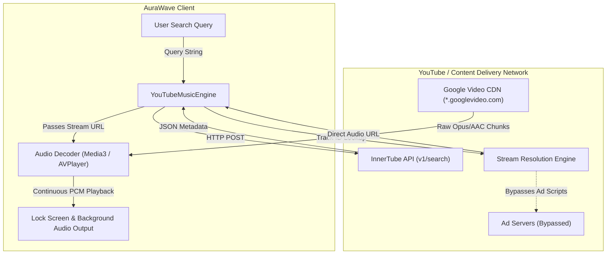
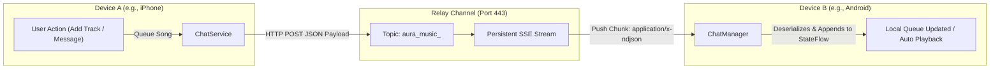
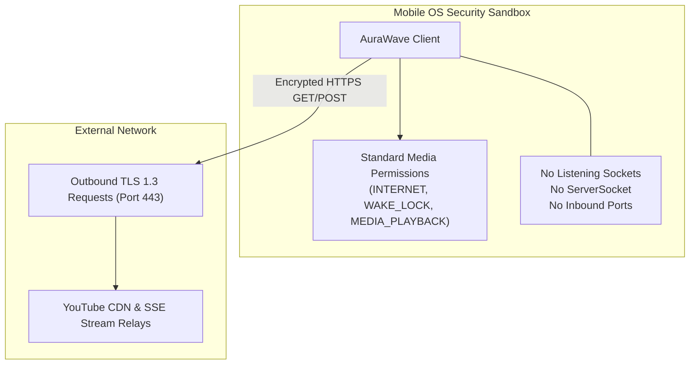

# AuraWave

[](https://github.com/aayushkumar20/aurawave)
[](https://opensource.org/licenses/MIT)
[-brightgreen.svg)](#)
[](#)
[](#)

AuraWave is an open-source, ad-free music streaming client and collaborative party-listening player. The system is implemented in native **Kotlin + Jetpack Compose** for Android, **Swift + SwiftUI** for iOS, and standard **JavaScript** for web browsers. It streams audio directly from YouTube Music infrastructure without requiring Google accounts, sign-ins, or telemetry.

---

## Technical Specifications

| Component | Android | iOS | Web |
| :--- | :--- | :--- | :--- |
| **Language** | Kotlin 1.9+ | Swift 5.9+ | Vanilla JavaScript (ES2022) |
| **UI Framework** | Jetpack Compose (Material 3) | SwiftUI | Semantic HTML5 + Custom CSS |
| **Audio Engine** | AndroidX Media3 (ExoPlayer) | AVFoundation (`AVPlayer`) | HTML5 Audio / YouTube IFrame Engine |
| **Background Service** | `MediaSessionService` (`FOREGROUND_SERVICE_MEDIA_PLAYBACK`) | `AVAudioSession` (`.playback` category) | Web Audio Context |
| **Lock-Screen Controls** | `MediaSession` + System Notification Shade | `MPNowPlayingInfoCenter` + `MPRemoteCommandCenter` | Media Session API (`navigator.mediaSession`) |
| **Real-Time Sync** | OkHttp Persistent SSE (`application/x-ndjson`) | URLSession Async Bytes Streaming (`URLSession.shared.bytes`) | EventSource / Fetch Streams |
| **JSON Serialization** | Gson + Lenient `Long`/`Double` TypeAdapters | Swift `Codable` (`Int64` timestamps) | Native `JSON.parse` / `JSON.stringify` |
| **Network Protocol** | Outbound HTTPS TLS 1.3 (Port 443) | Outbound HTTPS TLS 1.3 (Port 443) | Outbound HTTPS TLS 1.3 (Port 443) |

---

## Deep Technical Logic & Engineering Mechanics

### 1. YouTube InnerTube API & Bitstream Extraction Mechanics
Standard YouTube web clients and official mobile applications load multi-megabyte JavaScript bundles, execute telemetry trackers (`s.youtube.com`), and query advertising brokers (`doubleclick.net`) prior to media playback. AuraWave bypasses this entire pipeline by interacting directly with YouTube's backend endpoints.

```
+-----------------------------------------------------------------------------------------+
|                                    SEARCH PIPELINE                                      |
|                                                                                         |
|  User Query ----> POST https://www.youtube.com/youtubei/v1/search                       |
|                   Payload: { context: { client: { clientName: "WEB_REMIX", ... } } }    |
|                                                                                         |
|  Response   <---- InnerTube JSON (Traverses compactVideoRenderer nodes)                 |
|                   Extracts: videoId, title, artist name, duration, thumbnail URLs       |
+-----------------------------------------------------------------------------------------+
```

```
+-----------------------------------------------------------------------------------------+
|                                  PLAYBACK RESOLUTION                                    |
|                                                                                         |
|  Track ID   ----> Query Piped / Invidious Stream Manifest Endpoints                     |
|                                                                                         |
|  Filter     ----> Scans audioStreams[] array:                                           |
|                   1. mimeType: "audio/webm; codecs=\"opus\"" (~160 kbps, 48 kHz)       |
|                   2. mimeType: "audio/mp4; codecs=\"mp4a.40.2\"" (~128 kbps, 44.1 kHz)  |
|                                                                                         |
|  Stream URL ----> Direct Google Video CDN URL: https://*.googlevideo.com/videoplayback  |
|                   Directly streamed into native audio decoder (ExoPlayer / AVPlayer)    |
+-----------------------------------------------------------------------------------------+
```

#### Why Audio Ads Do Not Play
In official clients, advertisements are not embedded inside the song's audio file. Instead, the YouTube player app receives an ad playback manifest containing separate ad video IDs (`adformat=...`) and is instructed to play the ad stream before loading the music stream. 

Because AuraWave never executes the YouTube player script, it queries exclusively for the target song's `videoId`. The Google Video CDN receives an HTTP GET request for the specific audio stream chunks and returns raw Opus/AAC audio packets without injecting commercial interruptions.

---

### 2. Zero-Port Real-Time Synchronization Protocol
Most collaborative music applications require running local TCP sockets, opening firewall ports, or maintaining heavy bi-directional WebSocket infrastructure. AuraWave uses unidirectional Server-Sent Events (SSE) over persistent HTTPS connections on standard port 443.

```
+----------------+            POST /aura_music_<room_code>            +-------------------+
|  Device A      | -------------------------------------------------> |                   |
|  (Adds Track)  |           JSON: { type: "PLAYLIST_ADD", ... }      |  Relay Server     |
+----------------+                                                    |  (ntfy.sh / RTDB) |
                                                                      |                   |
+----------------+       Persistent SSE Stream (/json?since=4h)       |  Publishes packet |
|  Device B      | <================================================= |  to subscribed    |
|  (Receives)    |        Chunked Transfer: application/x-ndjson      |  channel topic    |
+----------------+                                                    +-------------------+
```

#### How the Stream Connection Works
1. **Connection Setup**: When a user joins a room (e.g., `AURA-1024`), the client computes a normalized topic string:
   $$\text{topic} = \text{"aura\_music\_"} + \text{roomId.trim().toLowerCase().replace("-", "\_")}$$
2. **Persistent Inbound Stream**:
   - **Android (`ChatManager.kt`)**: Uses an OkHttpClient instance configured with `readTimeout(0, TimeUnit.MILLISECONDS)`. It requests `https://ntfy.sh/<topic>/json?since=4h` and reads chunks in a continuous loop via `source.readUtf8Line()`.
   - **iOS (`ChatService.swift`)**: Uses Swift's asynchronous byte sequence:
     ```swift
     let (bytes, response) = try await URLSession.shared.bytes(for: request)
     for try await line in bytes.lines { ... }
     ```
3. **Outbound Broadcasting**: When a user posts a message or adds a song, the client issues an HTTP POST containing a `GroupSyncPacket` to `https://ntfy.sh/<topic>`. The relay server immediately multiplexes the payload to all active client connections listening on that topic.
4. **Security Profile**: The client only initiates outbound TCP connections to port 443. It never binds to local interfaces (`0.0.0.0` or `127.0.0.1`), eliminating listening socket attack surfaces.

---

### 3. Cross-Platform Serialization Mechanics
A common issue in cross-platform systems is serialization mismatch between dynamically-typed or IEEE 754 floating-point numbers and strongly-typed 64-bit integer fields.

#### The Problem
- Swift timestamps generated via `Date().timeIntervalSince1970 * 1000.0` produce floating-point values with decimal sub-millisecond precision (e.g., `1792919598970.263`).
- Kotlin's `ChatMessage.timestamp` and `Song.durationMs` are strictly typed as 64-bit signed integers (`Long`).
- Default Gson deserialization attempts `in.nextLong()`, which throws a `com.google.gson.JsonSyntaxException: java.lang.NumberFormatException: Expected a long but was 1792919598970.263`, silently dropping the packet.

#### The Solution
1. **Swift Encoder Fix**: Swift encodes explicit 64-bit integers:
   ```swift
   try container.encode(Int64(timestamp.timeIntervalSince1970 * 1000.0), forKey: .timestamp)
   ```
2. **Lenient Gson Deserializer**: Android registers fallback number adapters in `ChatManager.kt`:
   ```kotlin
   val gson = GsonBuilder()
       .registerTypeAdapter(Long::class.java, JsonDeserializer { json, _, _ ->
           try {
               if (json.isJsonPrimitive && json.asJsonPrimitive.isNumber) {
                   json.asDouble.toLong()
               } else {
                   json.asString.toDoubleOrNull()?.toLong() ?: 0L
               }
           } catch (_: Exception) { 0L }
       })
       .create()
   ```
This guarantees that regardless of whether a timestamp arrives as an integer, float, double, or numeric string, it parses cleanly without throwing unhandled exceptions.

---

### 4. Background Audio & Lock-Screen Lifecycle Management

```
+-----------------------------------------------------------------------------------------+
|                                    ANDROID LIFECYCLE                                    |
|                                                                                         |
|  PlaybackService extends MediaSessionService                                            |
|  ├── Declared foregroundServiceType="mediaPlayback" in AndroidManifest.xml              |
|  ├── Holds PARTIAL_WAKE_LOCK to keep CPU audio pipeline active during screen sleep     |
|  ├── ExoPlayer outputs PCM audio to Android AudioFlinger HAL                            |
|  └── MediaSession exposes MediaMetadataCompat to System Notification Shade & Lockscreen |
+-----------------------------------------------------------------------------------------+
```

```
+-----------------------------------------------------------------------------------------+
|                                      IOS LIFECYCLE                                      |
|                                                                                         |
|  AudioPlayerService                                                                     |
|  ├── AVAudioSession.sharedInstance().setCategory(.playback, mode: .default)            |
|  ├── Info.plist specifies UIBackgroundModes = ["audio"]                                 |
|  ├── MPNowPlayingInfoCenter updates title, artist, duration, elapsed time, artwork      |
|  └── MPRemoteCommandCenter binds playCommand, pauseCommand, changePlaybackPositionCommand|
+-----------------------------------------------------------------------------------------+
```

When the user turns off the screen:
- The OS puts the UI thread to sleep.
- The background audio service retains execution priority.
- Hardware media decoder buffers remain filled.
- The user controls playback directly from the lock-screen transport controls.

---

## System Architecture Flowcharts

### 1. End-to-End Audio Pipeline


---

### 2. Real-Time Room & Playlist Sync


---

### 3. Security & Sandboxing Model


---

## Directory Structure

```
aurawave/
├── AuraMusic-latest.apk        # Compiled Android debug APK
├── CONTRIBUTING.md             # Contribution rules and guidelines
├── CODE_OF_CONDUCT.md          # Contributor Covenant v2.1 code of conduct
├── LICENSE                     # MIT License
├── README.md                   # System documentation
│
├── android/                    # Android implementation (Kotlin, Jetpack Compose, Media3)
│   ├── app/
│   │   ├── build.gradle.kts    # Dependencies and build configuration
│   │   └── src/main/
│   │       ├── AndroidManifest.xml
│   │       └── java/com/auramusic/app/
│   │           ├── MainActivity.kt               # Root Activity & navigation host
│   │           ├── AuraApplication.kt           # Application base class
│   │           ├── data/
│   │           │   ├── models/Models.kt          # Data models (Song, ChatMessage, GroupSyncPacket)
│   │           │   ├── api/YouTubeMusicEngine.kt # Search parser & suggestion engine
│   │           │   └── repository/ChatManager.kt # SSE streaming & collaborative queue manager
│   │           ├── player/
│   │           │   ├── PlaybackManager.kt        # Playback controller (Play Next / Play Last)
│   │           │   ├── PlaybackService.kt        # Foreground MediaSessionService
│   │           │   └── YouTubeAudioEngine.kt     # Stream extractor
│   │           └── ui/
│   │               ├── screens/                  # Compose screens (Home, Search, Library, Chat)
│   │               └── theme/                    # Color palette and typography tokens
│
├── ios/                        # iOS implementation (Swift, SwiftUI, AVPlayer)
│   ├── AuraMusic.xcodeproj    # Xcode project file
│   ├── Package.swift           # Swift package dependencies
│   └── AuraMusic/
│       ├── AuraMusicApp.swift                    # Application entry point
│       ├── Info.plist                            # Audio background mode declarations
│       ├── Models/
│       │   └── Models.swift                      # Codable structs with Int64 timestamp handling
│       ├── Services/
│       │   ├── AudioPlayerService.swift          # AVPlayer & MPRemoteCommandCenter controller
│       │   ├── YouTubeMusicEngine.swift          # InnerTube search and stream extractor
│       │   └── ChatService.swift                 # SSE client and room manager
│       └── Views/                                # SwiftUI views (Home, Search, Library, Chat)
│
└── firebase/                   # Web implementation
    ├── database.rules.json     # Realtime Database rules
    ├── firebase.json           # Hosting configuration
    └── public/
        ├── index.html          # Web UI markup
        ├── style.css           # Styling rules
        └── app.js              # Web audio playback and SSE client
```

---

## Installation & Build Commands

### Android

#### Install Pre-Compiled APK
```bash
adb install -r "AuraMusic-latest.apk"
```

#### Build Debug APK from Source
```bash
cd android
./gradlew assembleDebug
```
The output file is generated at `android/app/build/outputs/apk/debug/app-debug.apk`.

---

### iOS

#### Build via Xcode
1. Open the project:
   ```bash
   open ios/AuraMusic.xcodeproj
   ```
2. Select your connected device or simulator in the scheme selector.
3. Select your development team under **Signing & Capabilities**.
4. Press `Cmd + B` to compile, or `Cmd + R` to deploy to device.

#### Validate Build via Command Line
```bash
xcodebuild -project ios/AuraMusic.xcodeproj -scheme AuraMusic -destination 'generic/platform=iOS' build CODE_SIGNING_ALLOWED=NO
```

---

### Web Player
Run a static server pointing to the web distribution:
```bash
npx serve firebase/public
```
Or open `firebase/public/index.html` directly in any standards-compliant browser.

---

## Security Model
- **No Listening Sockets**: The software does not open local ports or run background HTTP/TCP listener daemons.
- **Outbound Connections Only**: Communication is restricted to standard HTTPS queries on port 443.
- **No Privileged Permissions**: The app does not request access to contacts, location, camera, microphone, SMS, or local documents.
- **Client-Side Isolation**: Incoming network payloads are strictly parsed into static data models via Gson and Swift Codable.

---

## License
This project is released under the [MIT License](LICENSE).
